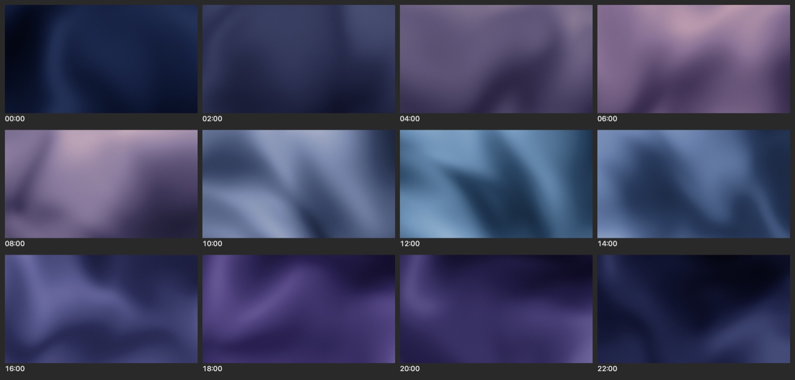

# Gloaming

Design soft, flowing gradient wallpapers for macOS, then export them as **native wallpapers**
that change through the day, on both the desktop and the lock screen.



*The built-in Winter preset, one frame every two hours.*

Gloaming is a small SwiftUI + Metal app. You pick or tweak a look in a live, animated preview,
and Gloaming renders it into the formats macOS already understands. No background process,
no login item, nothing running after you close it.

> **Status: early, pre-release (0.4).** It works and is used daily on the author's Mac, but
> there are no signed downloads yet. Build it from source (below).

## What it makes

| Export | What macOS does with it |
|---|---|
| **Dynamic: follows the sun** (default) | A multi-frame `.heic` tagged with sun positions. macOS shows dawn colours at your real sunrise, dusk at your real sunset, through the seasons. Light/Dark (Still) also work. Needs Location Services on. |
| **Dynamic: follows the clock** | Frames tied to clock times instead of the sun. For people who keep Location Services off. |
| **Light & Dark** | A two-frame `.heic` that switches with system appearance. |
| **Still** | A single PNG or HEIC at any size up to 16K. |
| **Variations** | A folder of stills for macOS's "rotate through folder". |

Gloaming never reads your location. macOS works out where the sun is on its own.

## Features

- Live animated preview: domain-warped gradient noise with OKLab colour blending, film grain and dithering (no banding).
- 19 built-in presets: moods (Calm, Focus, …), seasons (Winter, Spring, …) and vibes (Aurora, Spooky, Neon, …).
- Shape the day: a strip shows how the wallpaper looks at each hour, and you can set different palettes for night, morning and evening.
- Save, share and import your own presets (`.gloamingpreset`, plain JSON).
- Exports sized to your current display, any connected display, common Mac screens, or a custom size.
- Deterministic: the same look always renders the same pixels.
- No dependencies, no analytics, no network access.

## Requirements

- macOS 14 (Sonoma) or later. So far it has only been tested on Apple silicon with macOS 27.
- To build: Xcode **or** just the Command Line Tools (`xcode-select --install`), with Swift 6.

## Build and run

```bash
git clone https://github.com/davemshort/gloaming.git
cd gloaming
./Scripts/bundle.sh          # builds build/Gloaming.app (ad-hoc signed)
open build/Gloaming.app
```

Run the tests with `./Scripts/test.sh`.

Export a wallpaper, then set it in **System Settings → Wallpaper** with **Add Photo…** (or
drag the file in). Dynamic files show up as "Dynamic" in the wallpaper menu.

### Command line

The app binary also exports without opening a window:

```bash
G=build/Gloaming.app/Contents/MacOS/Gloaming
$G --export sun   --preset winter --out ~/Pictures/Gloaming     # follows the sun
$G --export time  --preset aurora --out ~/Pictures/Gloaming     # follows the clock
$G --export still --preset spooky --format heic --size 6016x3384 --out ~/Pictures/Gloaming
$G --export sheet --preset winter --out /tmp/review              # contact sheet of the day
```

See `Gloaming/App/LaunchOptions.swift` for every option.

## How it works

- **Rendering** (`Gloaming/Core/Rendering`): a two-pass Metal renderer. A reduced-resolution
  noise field, then a full-resolution composite with smooth upsampling, grain and dither.
  Shaders compile at runtime, so no Xcode project is needed.
- **Export** (`Gloaming/Core/Export`): ImageIO writes multi-image HEIC with Apple's
  `apple_desktop` metadata. That format isn't publicly documented, so what Gloaming writes is
  based on testing what macOS actually honours. The findings are written up in
  [`Documentation/`](Documentation/), especially
  [PhaseA-NativeFormats.md](Documentation/PhaseA-NativeFormats.md) and
  [PhaseA2-Solar.md](Documentation/PhaseA2-Solar.md).
- **Editor** (`Gloaming/App`): SwiftUI with undo, presets and an export sheet.

[`PROJECT.md`](PROJECT.md) is the full design spec, and `Documentation/` holds the notes from
each development phase. `Prototype/` is an earlier live-wallpaper experiment kept for reference;
it isn't part of the app.

## Roadmap

- "Set as Wallpaper" button
- Double-click to open `.gloamingpreset` files
- Signed and notarized downloads
- CI builds

## License

[MIT](LICENSE). Gloaming is an original implementation; it doesn't reuse code, shaders or
artwork from other wallpaper apps.
